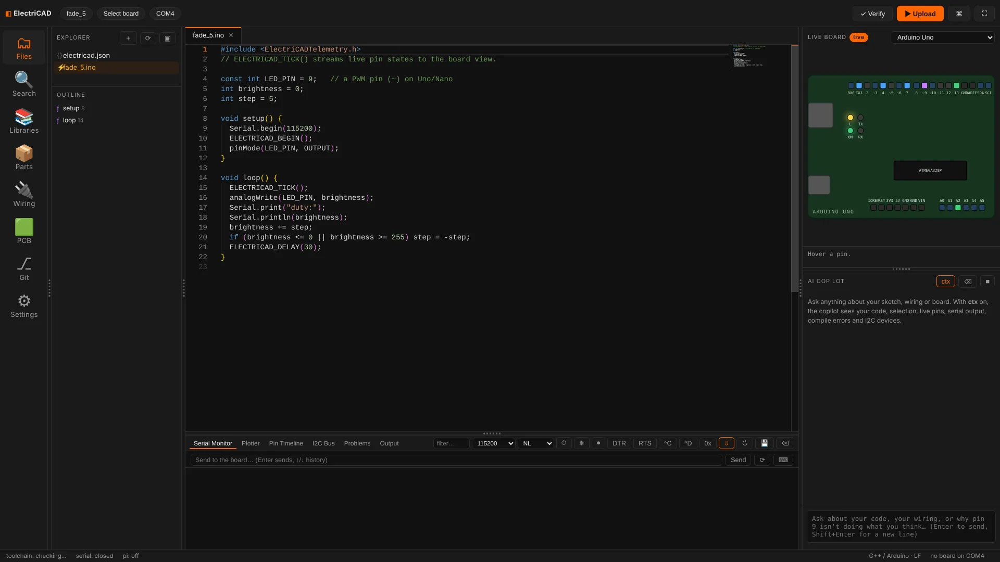
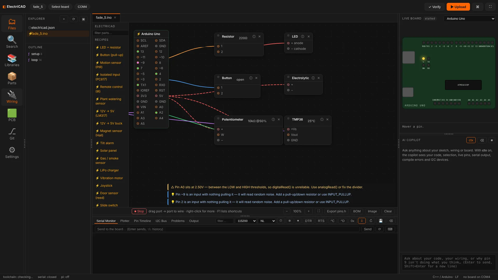
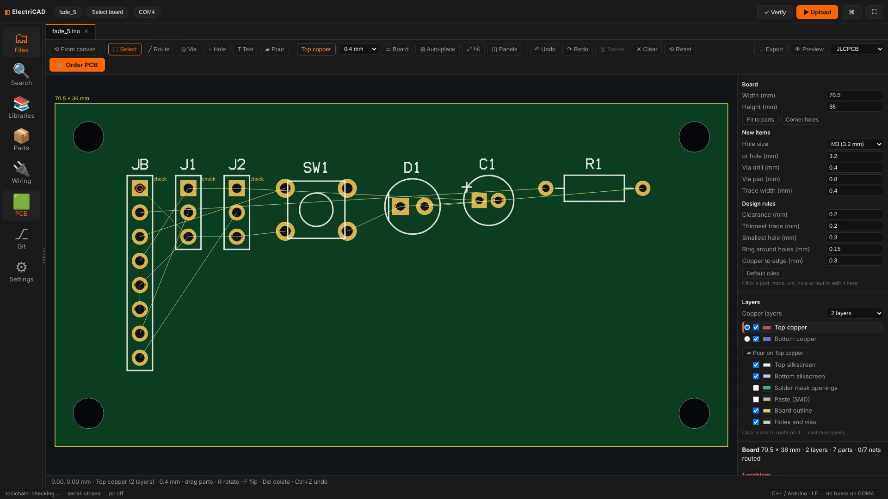

# ElectriCAD

The hardware IDE that can see your pins. A Windows desktop program for Arduino
and Raspberry Pi development where the board is a first-class live view: every
pin's mode, level, PWM duty, and analog value painted on a picture of the real
board in real time — with a real circuit simulator under the wiring canvas and
an AI copilot whose context includes the live hardware state, not just the code.

ElectriCAD is free and open source, made by [Kinode](https://usekinode.app/products/electricad)
and released under the GNU General Public License v3.0.

| Wiring canvas with the circuit simulator | PCB editor |
|---|---|
|  |  |

## Download

Windows installer and portable .exe:

- [usekinode.app/products/electricad](https://usekinode.app/products/electricad)
- [GitHub Releases](https://github.com/KinodeLLC/electricad/releases)

The portable .exe runs without installing. Both are free, with no account,
no trial and no paid tier.

What changed in each version is in [CHANGELOG.md](CHANGELOG.md).

## Building from source

    npm install
    npm start

To build the Windows installer and a portable .exe (written to `dist\`):

    npm run dist

First launch auto-downloads arduino-cli and the AVR core in the background —
watch the status bar. Board-manager URLs for ESP32, ESP8266, RP2040, Adafruit
and Teensy are pre-injected; compiling a detected board installs its core
automatically. No other setup.

## The pillars

1. **Live board view.** The bundled `ElectriCADTelemetry` Arduino library
   (`ELECTRICAD_BEGIN()` / `ELECTRICAD_TICK()`, plus `ELECTRICAD_DELAY(ms)`
   and `ELECTRICAD_I2C_SCAN(Wire)`) reads the port registers directly and
   streams a compact snapshot line over serial at 20 Hz: modes, levels,
   pull-ups, PWM duty, analog values. AVR, ESP32 (all 40 GPIOs), ESP8266,
   RP2040 and SAMD. The IDE paints the board SVG — Uno, Nano, Mega, ESP32,
   NodeMCU, Pico, the full-size Feather family (ESP32 / RP2040 / M0 / M4),
   and the Pi 40-pin header (via the pigpiod socket protocol, no agent).
2. **ElectriCAD canvas.** An n8n-style wiring designer with real electricity:
   nodal-analysis DC solver, iterated nonlinear devices (diodes by color,
   BJTs, MOSFETs, relays that really switch, fuses that really blow, the A4988
   that really current-limits), voltmeter/ammeter probes, a pot with a real
   wiper, a TMP36, and INPUT_PULLUP-aware pin reads (HIGH/LOW/FLOAT). Every part carries its knowledge — how it
   works, what voltage it is designed for, and exactly how it fails past
   absolute max — and its canonical hookup as a canvas-native schematic the
   app places pre-wired against the current board. Pan, zoom, drag-to-wire,
   undo/redo, duplicate/delete, pins.h and BOM (CSV, with catalog prices)
   export. The safety strip reads the solved circuit, not vibes.
3. **The Adafruit catalog, offline.** 5,500+ products baked in from the
   public products API: search, stock, prices, categories — and "Wire it":
   items are classified by interface (I2C/STEMMA QT, SPI, UART, analog,
   NeoPixel, servo, drivers…) and land on the canvas with the right canonical
   hookup and honest voltage ratings. Detected Adafruit hardware links back
   to its catalog entry. Refresh re-downloads politely (2 requests).
4. **A real toolchain.** arduino-cli underneath: continuous multi-device
   detection (arduino-cli match → 78 curated USB IDs → vendor catch-alls),
   cores auto-installed on first compile, the full library index, Problems
   panel with click-through diagnostics and one-click "find library" /
   "explain", flash + RAM usage after every build, cancellable builds,
   upload with recovery hints, binary export, library install from ZIP,
   upgrade-all for libraries and cores, multi-port serial with a hex view, a welcome screen and 17
   ready-to-run examples plus every installed library's examples, board
   options (CPU speed, partition scheme, USB mode), programmers and burn
   bootloader, a formatter, Arduino IntelliSense (completions, hover docs,
   signature help), an outline, find-in-project with regex, and a proper
   application menu with shortcuts (F1 lists them).
6. **Bench tools.** Serial monitor with timestamps, filter, baud switching,
   line endings, send history, board reset and log saving; a plotter that
   reads `label:value` or plain CSV with pause and CSV export; a pin timeline
   with frequency readout; an I2C panel that names every device on the bus.
5. **Native AI.** Anthropic / OpenAI-compatible / local Ollama — your key,
   your choice. The copilot's context automatically includes the open file,
   the board, the LIVE pin states, recent serial output, and the latest
   compile errors.
8. **Bench calculators and a pin checker.** Fourteen electronics
   calculators (LED resistor, dividers, colour codes, RC, 555, capacitor
   codes, AVR baud error, regulator heat, battery life and packs). The pin
   checker underlines wrong pins as you type — analogWrite on a non-PWM pin,
   ESP32 input-only and flash pins, ADC2 with WiFi — for the boards whose
   pinouts are documented, and stays silent on the rest.
7. **Python boards and source control.** MicroPython projects run straight
   from the editor over the raw REPL (F5 runs, Shift+F5 stops), upload to
   the board's filesystem, and browse its files. CircuitPython projects
   copy to the CIRCUITPY drive. A built-in git panel (Ctrl+Shift+G) stages,
   commits, diffs, pushes, pulls and blames.
8. **PCB layout and ordering.** The PCB tab turns the wiring canvas into a
   two-layer through-hole board: place, route, design-rule check, then
   export RS-274X Gerbers, Excellon drill, BOM, pick-and-place and a KiCad
   netlist. One button opens JLCPCB, PCBWay, OSH Park, Aisler, Eurocircuits
   or Seeed with the zip ready to drag in. Nothing is uploaded for you, and
   part numbers are never guessed.

## Layout

    main/       Electron main process — everything hardware-facing
      arduino.js      toolchain (bootstrap, cores auto-install, compile, upload)
      coreurls.js     board-manager index URLs + yaml injection (pure, tested)
      catalog.js      offline Adafruit catalog: search/refresh (pure, tested)
      detect.js       continuous device discovery (serial fingerprints + pi)
      serialbridge.js serial port + telemetry demux
      telemetry.js    wire-format parser (pure, tested)
      pigpio.js       raspberry pi network GPIO (pigpiod protocol)
      ai.js           streaming chat, hardware context assembly
      projects.js     project system (manifests; plain sketch folders import)
      examples.js     built-in example sketches
      zip.js          zip reader/writer (pure, tested)
      localhistory.js local history of saves + hot exit
    renderer/   UI — Monaco editor, board views, canvas, panels
      boards.js       board definitions (incl. the Feather family)
      board.js        live SVG renderer
      sim.js          the circuit solver + ratings engine (pure, tested)
      parts.js        parts knowledge base: ports, ratings, failure modes,
                      canonical hookups, catalog classification (pure, tested)
      history.js      canvas undo/redo (pure, tested)
      util.js         plot parsing, I2C names, pins.h + BOM builders (pure, tested)
      arduino-api.js  Arduino API reference for completions/hover (pure, tested)
      wiring.js       the canvas: pan/zoom, drag-to-wire, sim loop, info cards
      pcb.js          PCB engine: footprints, netlist, DRC, Gerber/Excellon (pure, tested)
      pcbview.js      the PCB tab (place, route, export, order)
      tools.js        number converter, CRCs, RGB565, bitmaps, notes (pure, tested)
      app.js          shell: tabs, tree, palette, menu commands, serial,
                      plotter, timeline, I2C, AI, catalog browser, settings
    library/ElectriCADTelemetry/   the Arduino-side telemetry library
    assets/adafruit-catalog.json   the baked offline catalog
    test/       node test/run-tests.js   (the full suite, incl. circuit physics and Gerber round trips)

## Wire format

    ~PN1|t=<ms>|m=<modeMaskHex>|o=<outLatchHex>|d=<levelsHex>|u=<pullupsHex>|a=<adc,csv>|p=<pin:duty,...>
    ~PNI|n=<count>|a=<hexAddr,...>                       (I2C scan result)

Markers are found anywhere in a line, so a `Serial.print` without a newline
before a tick never hides telemetry. An empty analog field means the pin was
in digital use and deliberately not sampled.

Human-readable on purpose — it survives any serial monitor and torn lines
parse partially instead of corrupting state.

## Contributing

Bug reports and pull requests are welcome. Run `npm test` before sending a
change; the suite covers the circuit solver, the PCB engine and Gerber output,
the telemetry parser and the zip writer, and needs no hardware.

## License

Copyright (C) 2026 Kinode LLC

This program is free software: you can redistribute it and/or modify it under
the terms of the GNU General Public License as published by the Free Software
Foundation, either version 3 of the License, or (at your option) any later
version. See [LICENSE](LICENSE) for the full text.

The offline Adafruit catalog in `assets/adafruit-catalog.json` is built from
Adafruit's public products API; product names and prices belong to Adafruit.
